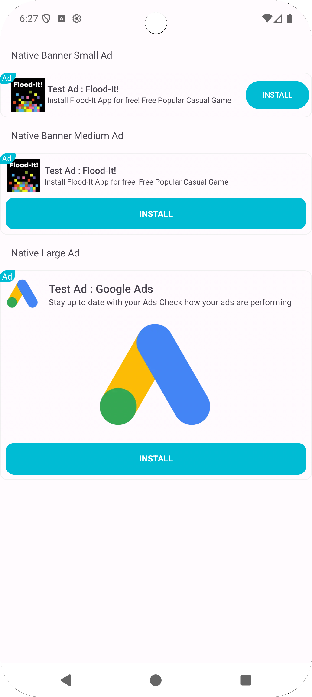
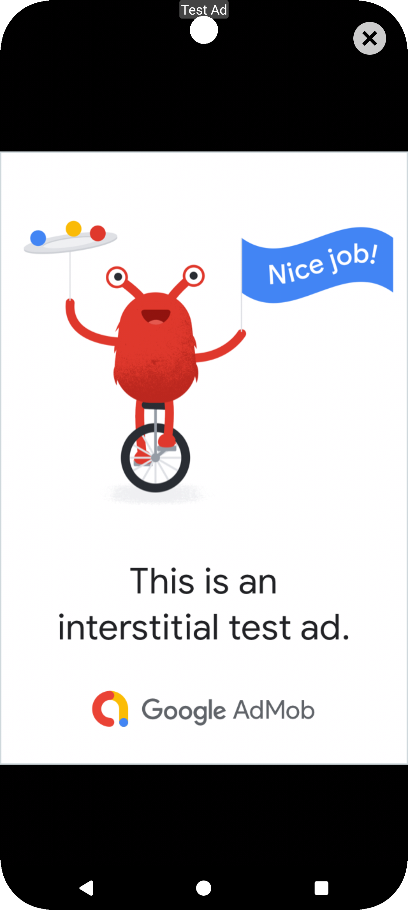
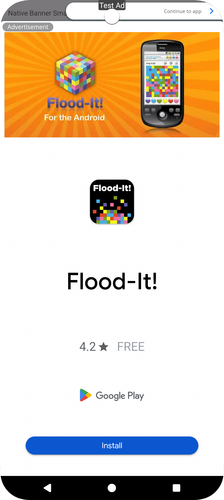
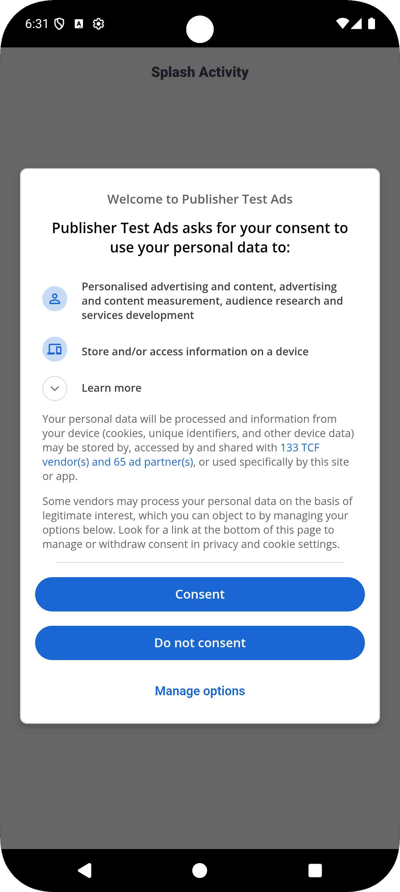

# AdManageKit
[](https://jitpack.io/#i2hammad/AdManageKit)


An Android library that takes the boilerplate out of **Google AdMob** ads, **Google Play Billing** and **UMP consent**, with optional multi-network waterfalls (Yandex) and Jetpack Compose support.

**Latest version: `4.4.8`** · [Release notes](docs/release-notes/RELEASE_NOTES_v4.4.8.md) · [Changelog](CHANGELOG.md)

> **Requires Kotlin 2.3+** in your app as of 4.4.8. ⚠️ **Avoid 4.4.3**: its billing regression makes purchases unusable.

[Features](#features) · [Requirements](#requirements) · [Installation](#installation) · [Quick Start](#quick-start) · [Usage](#usage) · [Documentation](#documentation) · [Migration Guide](#migration-guide)

## Features

| Area | What you get |
|---|---|
| **Ad formats** | Banner (all standard sizes, adaptive, collapsible), native (small / medium / large and 38 `NativeTemplateView` templates), interstitial, rewarded, app open |
| **Loading strategies** | `ON_DEMAND`, `ONLY_CACHE`, `HYBRID` per ad type; screen-aware native ad caching with LRU and expiry |
| **Frequency control** | Time- and count-based interstitial gating, ad pools, splash `showOrWaitForAd()`, app open activity/screen exclusion |
| **Reliability** | Retry with exponential backoff, main-thread callback delivery |
| **Waterfall** | AdMob → Yandex (or any provider) fallback per ad type, with no changes to your ad calls |
| **Billing** | Play Billing 9: subscriptions, one-time products, consumables, offers and paywalls, trial eligibility, account hold recovery |
| **Privacy** | UMP consent (GDPR/CCPA); ads hidden automatically for purchased users |
| **Compose** | Composable wrappers for every ad format |
| **Analytics** | Firebase `ad_impression`, `ad_paid_event` and `ad_failed_to_load` events for tROAS |

| Module | Artifact | Purpose |
|---|---|---|
| Ads | `ad-manage-kit` | Ad managers, views, waterfall, UMP |
| Core | `ad-manage-kit-core` | Shared interfaces and provider registry |
| Billing | `ad-manage-kit-billing` | Google Play Billing wrapper (`AppPurchase`) |
| Compose | `ad-manage-kit-compose` | Jetpack Compose components |
| Yandex | `ad-manage-kit-yandex` | Yandex Mobile Ads waterfall provider |

## Requirements

- `minSdk` **24**, `compileSdk` **37+**
- **Kotlin 2.3+** (the library and Firebase BOM 35 ship Kotlin 2.4 metadata)
- An explicit `MobileAds.initialize()` call before the first ad request (see [Quick Start](#quick-start))

### Next-Gen GMA SDK

Since **4.2.0**, AdManageKit runs on Google's **Next-Gen Google Mobile Ads SDK** (`com.google.android.libraries.ads.mobile.sdk`, `1.5.0` as of 4.4.8) instead of the legacy `play-services-ads`. Three things differ from the legacy SDK:

- **Initialization is explicit.** The SDK no longer lazy-inits on first use. AdManageKit doesn't call `MobileAds.initialize()` for you, because it doesn't own your consent flow.
- **Callbacks fire on a background thread.** Every AdManageKit manager, provider and view re-posts its callbacks to the main thread, so this is transparent to you.
- **Error and value types changed.** `AdKitError`, `AdKitLoadError` and `AdKitValue` now resolve to Next-Gen SDK types. Callback implementations don't need to change, only code that reads legacy-only fields. See [Migrating to 4.2.0](#migrating-to-420).

## Installation

Add JitPack to `settings.gradle`:

```groovy
dependencyResolutionManagement {
    repositoriesMode.set(RepositoriesMode.FAIL_ON_PROJECT_REPOS)
    repositories {
        mavenCentral()
        maven { url 'https://jitpack.io' }
    }
}
```

Add the modules you need to your app's `build.gradle`:

```groovy
implementation 'com.github.i2hammad.AdManageKit:ad-manage-kit:v4.4.8'
implementation 'com.github.i2hammad.AdManageKit:ad-manage-kit-billing:v4.4.8'
implementation 'com.github.i2hammad.AdManageKit:ad-manage-kit-core:v4.4.8'

// Optional: Jetpack Compose support
implementation 'com.github.i2hammad.AdManageKit:ad-manage-kit-compose:v4.4.8'

// Optional: Yandex Ads waterfall provider
implementation 'com.github.i2hammad.AdManageKit:ad-manage-kit-yandex:v4.4.8'
```

## Quick Start

Configure the library and initialize the SDK in your `Application`:

```kotlin
class MyApp : Application() {
    lateinit var appOpenManager: AppOpenManager

    override fun onCreate() {
        super.onCreate()

        AdManageKitConfig.apply {
            debugMode = BuildConfig.DEBUG
            autoRetryFailedAds = true
            interstitialLoadingStrategy = AdLoadingStrategy.HYBRID
            appOpenLoadingStrategy = AdLoadingStrategy.HYBRID
            nativeLoadingStrategy = AdLoadingStrategy.HYBRID
        }

        // Hide ads for users who bought premium
        BillingConfig.setPurchaseProvider(BillingPurchaseProvider())

        // initialize() must run off the main thread, and AppOpenManager must be
        // created only after it returns (the SDK rejects loads before that).
        val config = InitializationConfig.Builder("ca-app-pub-xxx~yyy").build()
        Thread {
            MobileAds.initialize(this, config)
            Handler(Looper.getMainLooper()).post {
                appOpenManager = AppOpenManager(this, "ca-app-pub-xxx/yyy")
            }
        }.start()
    }
}
```

Request consent before loading ads:

```kotlin
AdsConsentManager.getInstance(this).requestUMP(
    activity = this,
    isDebug = true,
    testDeviceId = "TEST_DEVICE_ID",
    resetConsent = false,
    listener = object : UMPResultListener {
        override fun onCheckUMPSuccess(isConsentGiven: Boolean) {
            if (isConsentGiven) {
                AdManager.getInstance().loadInterstitialAd(activity, adUnitId)
            }
        }
    }
)
```

The sample app's [`MyApplication.kt`](app/src/main/java/com/i2hammad/admanagekit/sample/MyApplication.kt) shows the full setup, including test device ids and the Yandex waterfall.

## Usage

### Banner Ads

```xml
<com.i2hammad.admanagekit.admob.BannerAdView
    android:id="@+id/bannerAdView"
    android:layout_width="match_parent"
    android:layout_height="wrap_content"
    app:bannerAdSize="adaptive" />
```

```kotlin
bannerAdView.loadBanner(this, "ca-app-pub-xxx/yyy")
// Fixed size: BANNER, LARGE_BANNER, MEDIUM_RECTANGLE, FULL_BANNER, LEADERBOARD
bannerAdView.loadBanner(this, "ca-app-pub-xxx/yyy", BannerAdSize.MEDIUM_RECTANGLE)
// Collapsible banner (adaptive size only)
bannerAdView.loadCollapsibleBanner(this, "ca-app-pub-xxx/yyy", true)
```

`ADAPTIVE` (the default) is Google's full-width anchored adaptive banner; `ADAPTIVE_LARGE` opts into the taller large anchored format. See the [Banner Ad Guide](docs/BANNER_AD_IMPROVEMENTS.md).

### Native Ads

`NativeTemplateView` renders any of 38 templates from XML or code:

```xml
<com.i2hammad.admanagekit.admob.NativeTemplateView
    android:id="@+id/nativeTemplateView"
    android:layout_width="match_parent"
    android:layout_height="wrap_content"
    app:adTemplate="material3" />
```

```kotlin
nativeTemplateView.setTemplate(NativeAdTemplate.MAGAZINE)
nativeTemplateView.loadNativeAd(activity, adUnitId, object : AdLoadCallback() {
    override fun onAdLoaded() { }
    override fun onFailedToLoad(error: AdError?) { }
})

// Override the loading strategy for one call
nativeTemplateView.loadNativeAd(activity, adUnitId, callback, AdLoadingStrategy.ONLY_CACHE)
```

Popular templates: `card_modern`, `material3`, `minimal`, `compact_horizontal`, `list_item`, `magazine`, `app_store`, `social_feed`, `medium_horizontal`, `flexible`, plus the `video_*` family. See the [NativeTemplateView Guide](docs/NATIVE_TEMPLATE_VIEW.md) for all 38.

The fixed-layout views `NativeBannerSmall`, `NativeBannerMedium` and `NativeLarge` work the same way:

```kotlin
nativeBannerSmall.loadNativeBannerAd(activity, adUnitId, useCachedAd = true)
```

### Interstitial Ads

```kotlin
val ads = AdManager.getInstance()
ads.loadInterstitialAd(this, "ca-app-pub-xxx/yyy")

val callback = object : AdManagerCallback() {
    override fun onNextAction() { navigateNext() }   // fires once on show, skip or failure
}
ads.forceShowInterstitial(this, callback)                          // show now
ads.forceShowInterstitialWithDialog(this, callback)                // with loading dialog
ads.showInterstitialAdByTime(this, callback)                       // at most every 15s (default)
ads.showInterstitialAdByCount(this, callback, maxDisplayCount = 3)

// Splash screen: show a ready ad, or wait up to the timeout for one
ads.showOrWaitForAd(activity = this, callback = callback, timeoutMillis = 10_000)
```

Ads reload after showing by default. Turn that off globally with `AdManageKitConfig.interstitialAutoReload = false`, or per call:

```kotlin
InterstitialAdBuilder.with(activity)
    .adUnit(adUnitId)
    .autoReload(true)
    .show { navigateNext() }
```

More: [Interstitial Ads](docs/interstitial-ads.md) · [InterstitialAdBuilder](docs/INTERSTITIAL_BUILDER_GUIDE.md) · [Frequency Control](docs/AD_FREQUENCY_CONTROL.md)

### Rewarded Ads

```kotlin
RewardedAdManager.initialize(context, "ca-app-pub-xxx/yyy")   // once, e.g. in Application

if (RewardedAdManager.isAdLoaded()) {
    RewardedAdManager.showAd(activity, object : RewardedAdManager.RewardedAdCallback {
        override fun onRewardEarned(rewardType: String, rewardAmount: Int) {
            grantReward(rewardType, rewardAmount)
        }
        override fun onAdDismissed() { continueGameFlow() }
    })
}

RewardedAdManager.loadRewardedAdWithTimeout(context, 5000, callback)  // splash screens
```

More: [Rewarded Ads](docs/rewarded-ads.md)

### App Open Ads

```kotlin
appOpenManager.disableAppOpenWithActivity(SplashActivity::class.java)  // exclude screens
appOpenManager.forceShowAdIfAvailable(activity, callback)
appOpenManager.skipNextAd()

// Pause around critical flows
appOpenManager.disableAppOpenAdsTemporarily()
appOpenManager.enableAppOpenAds()
```

Single-activity apps can exclude fragments or navigation destinations instead:

```kotlin
navController.addOnDestinationChangedListener { _, destination, _ ->
    appOpenManager.setCurrentScreenTag(destination.label?.toString())
}
appOpenManager.excludeScreenTags("Payment", "Onboarding", "Checkout")
```

More: [App Open Ads](docs/app-open-ads.md)

### Jetpack Compose

```kotlin
@Composable
fun MyScreen() {
    BannerAdCompose(adUnitId = "ca-app-pub-xxx/yyy")

    NativeTemplateCompose(
        adUnitId = "ca-app-pub-xxx/yyy",
        template = NativeAdTemplate.MATERIAL3,
        loadingStrategy = AdLoadingStrategy.HYBRID
    )

    val showInterstitial = rememberInterstitialAd(adUnitId = "ca-app-pub-xxx/yyy", preloadAd = true)
    Button(onClick = { showInterstitial() }) { Text("Show Ad") }

    // Hidden automatically for purchased users
    ConditionalAd {
        ProgrammaticNativeBannerMediumCompose(adUnitId = "ca-app-pub-xxx/yyy")
    }
}
```

More: [Jetpack Compose Integration](docs/COMPOSE_INTEGRATION.md)

### Multi-Provider Waterfall

Add Yandex (or another provider) as a fallback. Existing ad calls pick up the chain automatically:

```kotlin
// In Application.onCreate(), after AdManageKitConfig setup
YandexProviderRegistration.initialize(this)
val admob = AdMobProviderRegistration.create()
val yandex = YandexProviderRegistration.create()

// Map AdMob ad unit ids to their Yandex equivalents
AdUnitMapping.register("ca-app-pub-xxx/your-interstitial", mapOf("yandex" to "R-M-XXXXXX-Y"))

// Order = priority; set a chain per ad type
AdProviderConfig.setInterstitialChain(listOf(admob.interstitialProvider, yandex.interstitialProvider))
AdProviderConfig.setNativeChain(listOf(admob.nativeProvider, yandex.nativeProvider))
```

More: [Multi-Provider Waterfall](docs/MULTI_PROVIDER_WATERFALL.md) · [Yandex Integration](docs/YANDEX_INTEGRATION.md)

### In-App Purchases

```kotlin
val products = listOf(
    PurchaseItem("coins_100", TYPE_IAP.PURCHASE, PurchaseCategory.CONSUMABLE),
    PurchaseItem("remove_ads", TYPE_IAP.PURCHASE, PurchaseCategory.REMOVE_ADS),
    PurchaseItem("lifetime", TYPE_IAP.PURCHASE, PurchaseCategory.LIFETIME_PREMIUM),
    PurchaseItem("premium_monthly", "free_trial", TYPE_IAP.SUBSCRIPTION)
)
val billing = AppPurchase.getInstance()
billing.initBilling(application, products)

billing.purchase(activity, "remove_ads")
billing.subscribe(activity, "premium_monthly")

if (billing.isPurchased()) { /* subscription, lifetime or remove_ads */ }

// Consumables are not auto-consumed: grant, then consume
billing.setPurchaseHistoryListener(object : PurchaseHistoryListener {
    override fun onNewPurchase(productId: String, purchase: PurchaseResult) {
        if (productId == "coins_100") {
            addCoins(100 * purchase.quantity)
            billing.consumePurchase(productId)
        }
    }
    override fun onPurchaseConsumed(productId: String, purchase: PurchaseResult) { }
})
```

#### Subscription Offers & Paywalls

Play returns only the offers this account is eligible for. Buy the exact offer the user tapped, since `subscribe(activity, subsId)` picks one for you:

```kotlin
val offers = billing.getOffers("premium_sub")
billing.subscribe(activity, offers[selectedIndex])

billing.getOfferByBasePlanId("premium_sub", "yearly")
billing.getOfferByTag("premium_sub", "popular")        // Play Console offer tag
billing.getBestValueOffer("premium_sub")               // lowest cost per month

val offer = billing.getBaseOffer("premium_yearly") ?: return
priceLabel.text    = offer.basePrice                   // "$59.99"
perMonthLabel.text = AppPurchase.formatPrice(offer.pricePerMonthMicros, offer.currencyCode)
todayLabel.text    = offer.firstCyclePrice             // "Free", "$1.99" or "$59.99"

val savings = billing.getSavingsPercent("premium_monthly", "premium_yearly")  // "Save 50%"
subscribeButton.text = if (billing.isEligibleForFreeTrial("premium_sub")) "Start free trial" else "Subscribe"
```

One-time products can carry several offers too (discounts, rentals, pre-orders): see `getBestOneTimeOffer()` in the [In-App Purchase Guide](docs/APP_PURCHASE_GUIDE.md).

#### Subscription State & Account Hold

```kotlin
when (billing.getSubscriptionState("premium_monthly")) {
    SubscriptionState.ACTIVE    -> showPremiumUI()
    SubscriptionState.CANCELLED -> showRenewalPrompt()     // still has access
    SubscriptionState.ON_HOLD   -> showFixPaymentPrompt()  // payment declined, no access
    SubscriptionState.EXPIRED   -> showSubscribeButton()
}

billing.upgradeSubscription(activity, "premium_yearly")
billing.downgradeSubscription(activity, "premium_basic")

// Let Play walk the user through fixing a declined payment
if (billing.hasSubscriptionOnHold()) {
    billing.showInAppMessages(activity, object : InAppMessageListener {
        override fun onSubscriptionRecovered(purchaseToken: String) { refreshPremiumUi() }
        override fun onNoActionNeeded() { }
    })
}
```

> `isSubscriptionActive()` returns `false` during account hold, as Google requires. Check `isSuspended()` if you deliberately keep serving those users.

**Empty paywall?** Register a `ProductDetailsListener` **before** `initBilling`. Its `unfetched` list names each product id Play declined and why: a misspelled id, an inactive product, or an account that can't see the release track.

More: [In-App Purchase Guide](docs/APP_PURCHASE_GUIDE.md) · [Subscription Offers](wiki/Subscription-Offers.md) · [Subscription Upgrades](wiki/Subscription-Upgrades.md)

## Screenshots

| NativeBannerSmall Ad | Interstitial Ad | App Open Ad | UMP Consent Form |
|----------------------|-----------------|-----------------|------------------|
|  |  |  |  |

[Watch the demo on YouTube](https://youtube.com/shorts/h_872tOARpU)

## Documentation

| Topic | Guide |
|---|---|
| Configuration | [Configuration Usage](docs/CONFIGURATION_USAGE.md) · [Java Usage](docs/JAVA_USAGE_GUIDE.md) |
| Native ads | [NativeTemplateView](docs/NATIVE_TEMPLATE_VIEW.md) · [Native Ads Caching](docs/native-ads-caching.md) · [Preloading](docs/NATIVE_AD_PRELOADING.md) |
| Loading strategies | [Ad Loading Strategies](docs/AD_LOADING_STRATEGIES.md) · [Examples](docs/LOADING_STRATEGY_EXAMPLES.md) |
| Full-screen ads | [Interstitial](docs/interstitial-ads.md) · [Rewarded](docs/rewarded-ads.md) · [App Open](docs/app-open-ads.md) |
| Compose | [Jetpack Compose Integration](docs/COMPOSE_INTEGRATION.md) |
| Waterfall | [Multi-Provider Waterfall](docs/MULTI_PROVIDER_WATERFALL.md) · [Yandex Integration](docs/YANDEX_INTEGRATION.md) |
| Billing | [In-App Purchase Guide](docs/APP_PURCHASE_GUIDE.md) · [Purchase Categories](wiki/Purchase-Categories.md) · [Consumables](wiki/Consumable-Products.md) · [Subscriptions](wiki/Subscriptions.md) |
| Reference | [API Reference](docs/API_REFERENCE.md) · [Dokka API docs](https://i2hammad.github.io/AdManageKit/) (`./gradlew dokkaGenerateHtml` to build locally) |
| History | [Changelog](CHANGELOG.md) · [Release notes](docs/release-notes/) |

### MCP Server (AI Integration)

[](https://www.npmjs.com/package/admanagekit-mcp-server)

An [MCP](https://modelcontextprotocol.io/) server lets Claude Code, Claude Desktop, Cursor and other MCP clients search these docs and generate AdManageKit integration code (ads, billing, Compose; Kotlin or Java):

```json
{
  "mcpServers": {
    "admanagekit": {
      "command": "npx",
      "args": ["-y", "admanagekit-mcp-server"]
    }
  }
}
```

It's configured automatically when you work in this repo. See [mcp-server/](mcp-server/).

---

## Migration Guide

### Migrating to 4.2.0

The Next-Gen GMA SDK swap (see [Next-Gen GMA SDK](#next-gen-gma-sdk)) is **source-compatible for most consumers**. It only affects you if your code does one of the following:

**1. You read specific members of an error/value object, not just call the callback method.**

`AdKitError`/`AdKitLoadError` now resolve to the Next-Gen SDK's `LoadAdError`, which drops the old `domain`/`cause` fields and replaces the free-form `Int` error code with a closed `LoadAdError.ErrorCode` enum:

```kotlin
// Before (4.1.x and earlier)
override fun onFailedToLoad(error: AdKitError?) {
    Log.e(TAG, "Failed: ${error?.code} / ${error?.domain}")  // .domain no longer exists
}

// After (4.2.0)
override fun onFailedToLoad(error: AdKitError?) {
    Log.e(TAG, "Failed: ${error?.code}")  // .code is now a LoadAdError.ErrorCode enum, still fine to log
}
```

**2. You use the raw-callback overload of `AdManager.loadInterstitialAd`.**

```kotlin
// Before
AdManager.getInstance().loadInterstitialAd(context, adUnitId,
    object : com.google.android.gms.ads.interstitial.InterstitialAdLoadCallback() {
        override fun onAdLoaded(ad: com.google.android.gms.ads.interstitial.InterstitialAd) { }
        override fun onAdFailedToLoad(error: com.google.android.gms.ads.LoadAdError) { }
    })

// After
AdManager.getInstance().loadInterstitialAd(context, adUnitId,
    object : com.google.android.libraries.ads.mobile.sdk.common.AdLoadCallback<
        com.google.android.libraries.ads.mobile.sdk.interstitial.InterstitialAd> {
        override fun onAdLoaded(ad: InterstitialAd) { }
        override fun onAdFailedToLoad(adError: LoadAdError) { }
    })
```

**3. You supply a custom native ad layout XML.**

```xml
<!-- Before -->
<com.google.android.gms.ads.nativead.NativeAdView ...>
    <com.google.android.gms.ads.nativead.MediaView android:id="@+id/ad_media" ... />
    <com.google.android.gms.ads.nativead.AdChoicesView android:id="@+id/ad_choices_view" ... />
</com.google.android.gms.ads.nativead.NativeAdView>

<!-- After -->
<com.google.android.libraries.ads.mobile.sdk.nativead.NativeAdView ...>
    <com.google.android.libraries.ads.mobile.sdk.nativead.MediaView android:id="@+id/ad_media" ... />
    <com.google.android.libraries.ads.mobile.sdk.common.AdChoicesView android:id="@+id/ad_choices_view" ... />
</com.google.android.libraries.ads.mobile.sdk.nativead.NativeAdView>
```

**4. Your Compose callback lambdas' parameter types are explicitly typed.**

If you wrote `onAdFailedToLoad: (com.google.android.gms.ads.LoadAdError?) -> Unit = { ... }` explicitly rather than letting Kotlin infer the type from the composable's signature, update the import to `com.google.android.libraries.ads.mobile.sdk.common.LoadAdError`.

**Everything else:**

- Call `MobileAds.initialize()` once at app startup if you haven't already — see [Next-Gen GMA SDK](#next-gen-gma-sdk). AdManageKit doesn't do this for you.
- Bump `compileSdk` to **37+**.
- If you relied on `BannerAdView`/`BannerAdProvider`'s `pause()`/`resume()` actually pausing ad refresh, that's now a no-op — the Next-Gen SDK's `AdView` doesn't expose it.
- Google Play Billing 9.1.0 needs no changes if you only use `AppPurchase`/`PurchaseItem`.

See [Release Notes v4.2.0](docs/release-notes/RELEASE_NOTES_v4.2.0.md) for the full technical writeup.

### Migrating to 3.0.0

Version 3.0.0 is **fully backward compatible**. Optionally adopt new features:

#### Smart Splash Ads (Recommended)

Replace separate load + show calls with single `showOrWaitForAd()`:

```kotlin
// Before (v2.9.0) - Two-step approach
AdManager.getInstance().loadInterstitialAdForSplash(this, adUnitId, 10_000, object : AdManagerCallback() {
    override fun onNextAction() {
        AdManager.getInstance().forceShowInterstitial(this@SplashActivity, callback)
    }
})

// After (v3.0.0) - Single smart call
AdManager.getInstance().showOrWaitForAd(
    activity = this,
    callback = object : AdManagerCallback() {
        override fun onNextAction() { navigateNext() }
    },
    timeoutMillis = 10_000
)
```

#### Ad Pool for Higher Show Rate

```kotlin
// Before (single ad unit)
AdManager.getInstance().loadInterstitialAd(context, "single_unit")

// After (multiple ad units for redundancy)
AdManager.getInstance().loadMultipleAdUnits(context, "high_ecpm", "medium_ecpm", "fallback")
```

#### App Open Ad Prefetching

```kotlin
// Prefetch before external intents
appOpenManager.prefetchNextAd()
startActivityForResult(cameraIntent, REQUEST_CODE)
```

### Migrating to 2.9.0

Version 2.9.0 has **one breaking change** for consumable products:

**Consumables are no longer auto-consumed.** You must manually call `consumePurchase()`:

```kotlin
// Before v2.9.0 (auto-consume)
AppPurchase.getInstance().setConsumePurchase(true)  // Deprecated

// After v2.9.0 (manual consume)
AppPurchase.getInstance().setPurchaseHistoryListener(object : PurchaseHistoryListener {
    override fun onNewPurchase(productId: String, purchase: PurchaseResult) {
        grantItems(productId, purchase.quantity)
        AppPurchase.getInstance().consumePurchase(productId)  // Manual!
    }
    override fun onPurchaseConsumed(productId: String, purchase: PurchaseResult) { }
})
```

**Use Purchase Categories** for better product classification:

```kotlin
// Before
PurchaseItem("coins", TYPE_IAP.PURCHASE, true)  // isConsumable

// After (explicit categories)
PurchaseItem("coins", TYPE_IAP.PURCHASE, PurchaseCategory.CONSUMABLE)
PurchaseItem("remove_ads", TYPE_IAP.PURCHASE, PurchaseCategory.REMOVE_ADS)
```

### Migrating to 2.8.0

Version 2.8.0 is **fully backward compatible** with one behavioral change:

**`forceShowInterstitial()` now respects loading strategy:**
```kotlin
// If you need old behavior (always force fetch), use:
AdManager.getInstance().forceShowInterstitialAlways(activity, callback)

// Or set strategy to ON_DEMAND globally:
AdManageKitConfig.interstitialLoadingStrategy = AdLoadingStrategy.ON_DEMAND
```

### Migrating to 2.7.0

Version 2.7.0 is **fully backward compatible**. Optionally adopt new features:

```kotlin
// Old way (still works)
val nativeBannerMedium = NativeBannerMedium(context)
nativeBannerMedium.loadNativeBannerAd(activity, adUnitId)

// New unified approach
val nativeTemplateView = NativeTemplateView(context)
nativeTemplateView.setTemplate(NativeAdTemplate.CARD_MODERN)
nativeTemplateView.loadNativeAd(activity, adUnitId)
```

---

## Sample Project

The `app` module demonstrates all features. To run:

1. Clone: `git clone https://github.com/i2hammad/AdManageKit.git`
2. Open in Android Studio
3. Replace placeholder AdMob IDs
4. Run on device or emulator

---

## Contributing

1. Fork the repository
2. Create a branch (`git checkout -b feature/YourFeature`)
3. Commit changes (`git commit -m 'Add YourFeature'`)
4. Push (`git push origin feature/YourFeature`)
5. Open a Pull Request

## License

Licensed under the MIT License. See [LICENSE](LICENSE).

## Support

[Buy me a coffee](https://buymeacoffee.com/i2hammad)

For issues: [GitHub Issues](https://github.com/i2hammad/AdManageKit/issues) or [hammadmughal0001@gmail.com](mailto:hammadmughal0001@gmail.com)
